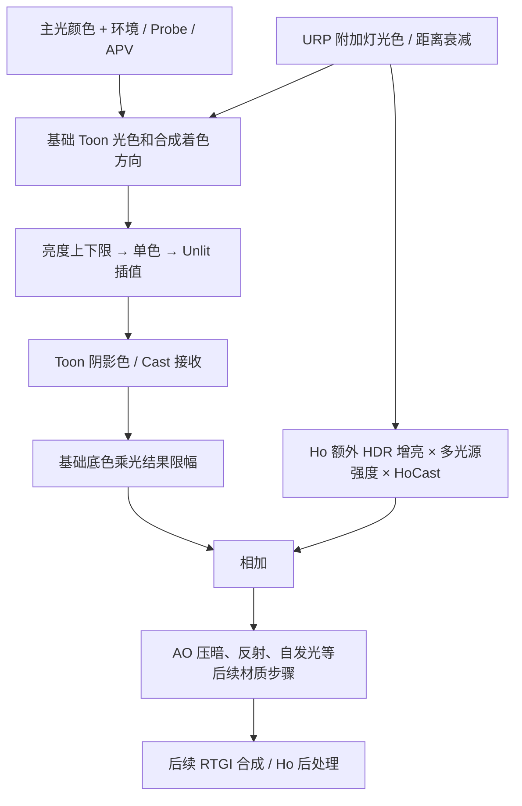

# Ho lilToon「照明」参数与接入审计

2026-11-03。生产源码：lilToon `91876d3`、URP Extensions `390c1636`。范围是新版 / 旧版 Inspector 的照明输入及标准 forward Shader 路径；共享 PC Renderer 配置为 Forward+，附加光按像素处理。不是对每个制作场景、所有材质变体的视觉验收。

本次只增加审计说明和隔离测试工具，不改生产 Shader 算法、材质、灯光或场景。对照官方 lilToon **2.3.2 tag** 的 `lil_common_macro.hlsl`、`lil_common_functions.hlsl`、`lil_common_frag.hlsl`；下载快照留在本机 `D:/Unity_Fork/lilToon-URP-Extensions/Temp~/LightingParameterAudit-20261103/upstream-2.3.2-*.hlsl`。

## 当前结论

基础亮度校正、环境对阴影色的影响和方向覆盖仍有执行路径。Ho HDR 补光在基础 Toon 光照之后另加一遍颜色，没有统一经过亮度上限、单色和 Unlit 控制，因此这些参数不能当成整个材质 / 最终画面的总控。

四个需要明确标识的无效入口：

- **顶点灯强度**：当前附加光宏强度固定为 1，不读取 `_VertexLightStrength`。上游中这项主要用于 Built-in RP，原版 URP 也使用固定强度 1。
- **曝光前最大亮度、定向光强度**：上游只在 HDRP 分支使用；当前 URP 实现没有执行读取，不是 Ho 后处理曝光或天光强度入口。
- **多光源阴影强度**：当前 `minShadow` 初始化为 1 后从未更新，最终始终乘 `lerp(1,1,strength)`。这项是真正的接入缺口，不能用于关掉 HoShadowCast。

## 逐项说明

下列默认值来自属性模板 / 默认设置，并不代表用户所有已制作材质的当前值。

| 参数 / 属性 | 调节含义 | 当前有效范围与限制 |
| --- | --- | --- |
| **亮度下限** `_LightMinLimit`，通常 0.05 | 为基础光色保底，暗环境中避免基础颜色完全黑掉。按 **R/G/B 各通道**夹取，不是按最终像素亮度或曝光。 | 有效。会给彩色灯缺少的通道也补下限，使暗处偏白；仍可能被 Toon 阴影、AO 等压暗。不能替代环境光 / GI。 |
| **亮度上限** `_LightMaxLimit`，通常 1 | 限制基础 Toon 光色和该路径的底色乘光结果。调大允许该路径更亮。 | 有效，但不是最终 HDR / 画面上限。Ho HDR 补光在限幅后加入，反射、自发光及后续合成也不能简单由它代表。部分 Lightmap 分支还有更早的 `saturate`，不保证把上限调大就能恢复已被夹掉的 HDR。 |
| **单色照明** `_MonochromeLighting`，0～1 | 将基础光色向 `(R+G+B)/3` 的灰色插值；1 时基础受光不再带灯光色。不会把材质贴图变黑白。 | 基础路径有效。Ho HDR 补光未走这一步，仍能保留彩色；不是后处理饱和度。 |
| **阴影颜色的环境影响** `_ShadowEnvStrength`，0～1 | 用 SH / Probe / APV 求得的暗侧环境光，把 Toon 阴影色向原底色拉回，减少阴影的染色和压暗。 | 在 `_UseShadow` / 编译的 Toon 阴影功能启用时有效，结果又被限制为不超过亮侧底色。不是 RTGI 强度、反射强度或 ShadowMap 清晰度；环境本来接近黑时影响很小。 |
| **Unlit 化** `_AsUnlit`，0～1 | 把基础光色向白色 1 插值，使基础受光不再依赖环境明暗与颜色。 | 基础路径有效；不会单独关闭 Toon 阴影、Cast 或 AO。Ho HDR 补光未乘 `(1-AsUnlit)`，1 时仍可能被额外照亮。不能理解为材质全部退化为纯 Unlit。 |
| **顶点灯强度** `_VertexLightStrength`，0～1 | 上游 Built-in RP 的部分顶点灯 / 附加光权重。 | 当前 URP 无效，不控制 Forward+ 光源数，也不是现在的多光源总强度。 |
| **多光源强度** `_MultiLightIntensity`，0～5 | Ho 新增的额外 HDR 增亮：`底色 × 附加光色和 × HoCast可见度 × 强度`。 | 有效。附加光已经参与基础 Toon 光色 / 合成方向，这里是第二条路径；0 只关掉额外增亮，不能停止接受点光 / 聚光。1 不等于严格物理的“正常一次”。 |
| **多光源阴影强度** `_MultiLightCastShadowStrength`，0～1 | 代码形状像是打算用附加光最暗的阴影可见度再乘结果。 | 当前无效：`minShadow` 始终为 1。URP 的 `Light.shadowAttenuation` 即使被计算，也没有在这些颜色累加中被消费。 |
| **HoRP阴影模式** `_HoRPShadowMode` | Main / 主阴影：基础主光 Cast + 明确加入 Main 的 Ho 补充灯；Full / 全阴影：再接收 HoShadowCast 的其余合资格灯。 | 模式筛选已接入；0 / 缺失按 Main。Main 基础优先使用有效 RTShadow，之后是匹配角色的 CharacterShadow，再回退 URP 主光。此入口不会切换光源颜色强度；目前 Full **不是** URP 原生逐灯阴影 / 完整 Shadowmask / 未来 RT 无限灯的统一池。相关 Feature 未启用时两个模式可能相同。 |
| **定向光覆盖** `_LightDirectionOverride.xyz` | 向主光 + 环境推导方向 + 附加光合成方向中加入一个人为方向向量，归一化后用于 Toon 等着色。长度决定竞争权重。 | 有效，是“方向偏置”而非绝对替换。不会旋转真实 Light、移动 ShadowMap 或改变物理投影方向。还会通过旧方向差公式减弱 Cast 接收，见下文。 |
| **跟随对象方向** `_LightDirectionOverride.w` | 关：向量使用世界方向；开：先按物体矩阵转换成世界方向，并保留输入长度。 | 有效。转动物体时，开关决定人为偏置是否跟随物体转动。xyz 接近全零用于基本不干预，模板保留微小非零值，不建议随意制造零向量归一化。 |
| **曝光前最大亮度** `_BeforeExposureLimit`，通常 10000 | 原版 HDRP 在应用曝光倍率前夹取主光颜色。 | 当前 URP 无执行路径，不控制 Ho 的映射 / 曝光。 |
| **定向光强度** `_lilDirectionalLightStrength`，通常 1 | 原版 HDRP 的主光颜色倍率。 | 当前 URP 无执行路径。要改实际天光应改 Light 或管线对应入口，不能靠这项。 |
| **[Built-in RP] 透明度提升 / 光照混合** `_AlphaBoostFA` / `_BlendOpFA` | 原版独立 ForwardAdd Pass 的透明预乘及 Add / Max 混合设置。 | 当前常规 URP 单 Pass / Forward+ 不走那套逐灯 ForwardAdd；当前面板仍展示了这些兼容入口。不要用它们调整 Ho HDR 多光源或透明主体。 |

**默认 / 半单色预设按钮**只批量设置一部分旧照明参数，不会重设 HoRP 阴影模式、多光源 HDR 强度、无效的多光源 Cast 强度或方向覆盖。半单色把单色设为 0.5、基础上下限设为 0.05 / 1、Unlit 设为 0、环境影响设为 0，并写入几个旧兼容字段；默认读取 Shader 全局默认设置。它们不是整个 Ho 光照的“一键还原”。详见 [ApplyLightingPreset](../Assets/lilToon/Editor/lilInspector/lilGUIUtility.cs)。

## 实际光色链路



图示省略材质层、轮廓等分支。普通 Forward+ 的基础附加灯与 Ho HDR 使用同一批 URP 灯光候选，在不同阶段参与两次；真实画面受限幅和 Toon 分层影响，不能把结果概括成所有像素都简单翻倍。

Ho RTGI 有独立的屏幕合成入口，不会自动继承这套材质校正参数。[RTGI 合成源码](../../lilToon-URP-Extensions/Runtime/RTGI/Shaders/HoRTGIComposite.shader) 对合格表面向原画面加 GI；此次未做 RTGI / APV 整场景量化。

## 方向覆盖与 Cast 为什么会互相影响

当前仍保留上游的接收公式：

```text
Toon 用的 Cast 可见度 = saturate(采样的 Cast 可见度 + distance(合成着色方向, 真实主光方向))
```

可见度 0 表示遮挡，1 表示无遮挡。方向覆盖、环境方向、附加灯的方向都可能改变“合成着色方向”，而真实主光方向不随材质参数改变。当二者都是单位向量时，方向差为 `2*sin(夹角/2)`：

| 原采样为全黑的遮挡 | 送入 Toon 接收的可见度 |
| --- | ---: |
| 方向一致 | 0 |
| 相差 30° | 约 0.518 |
| 相差 60°或更多 | 1，遮挡被完全放开 |

这不是 ShadowMap 分辨率变低，也不是物理投影随覆盖方向移动。公式属于原版用艺术方向弱化不匹配投影的设计；Ho 把 RTShadow / CharacterShadow / 补充 Cast 接进同一 attenuation 后也受它影响。**精细打出的斑驳投影可能在材质接收阶段被冲淡，单查阴影贴图会误判。**

`_ShadowReceive`、第二 / 第三层接收以及接收遮罩还会继续决定每层是否使用上述可见度。关闭 Toon 阴影也不会自动关闭 Ho HDR 分支里独立乘上的 HoCast。

## 当前可操作建议与待设计事项

对已经制作好的材质，先把 **亮度下限、亮度上限、单色照明、阴影颜色的环境影响** 当成基础 Toon 外观工具；其中环境影响是保留阴影层次同时抬暗部的入口之一。精细投影审查时保持方向覆盖接近原默认，再检查额外灯是否把合成方向拉偏。不要把 `_AsUnlit=1` 当作验证“整条管线所有光照都关掉”的手段。

需要按这个次序理清契约后再修 Shader：

1. 将跨管线无效项从两套 Inspector / 批量面板的支持范围一致地隐藏；资产属性可保留兼容，避免纯清理字段导致已有材质变化。
2. 明确多光源是基础 Toon 受光、额外 HDR 增亮，还是新的逐灯颜色接口。当前参数应说明是额外增亮，不宜未经对照直接删除第二条路径。
3. 明确单色、Unlit、上限应只管基础路径还是全部材质 diffuse。不要把上限简单粗暴地夹到最终结果上，误伤自发光 / 反射 / Bloom。
4. 多光源 Cast 强度需要按 Main / Full 及逐灯归属重新接入。不要只补一句“取所有灯最小可见度”就交付，否则会让一个灯的遮挡压暗另一个灯的颜色，再次混淆颜色与 Cast。
5. 给艺术方向对 Cast 的补偿明确控制边界。需要稳定斑驳 / RT 角色投影时，应允许不受着色方向偏差冲淡；修改默认行为前做已有材质 A/B，不能直接全局删公式。

这些是调查得到的修复方向，尚未修改生产参数语义。

## 证据与验证边界

在独立物理副本 `D:/HoBakeAudit26`、Unity 6000.3.15f1 / D3D12 上，按当前生产源码原样提取运算核，用固定合成灯 / Cast 值进行真实 GPU Blit 和浮点回读：**14/14 通过，0 failed、0 skipped**。覆盖 RGB 限幅、算术平均去色、基础 Unlit、HDR 绕过这些控制、多光源两条路径、Cast 强度无效、方向差补偿和世界 / 对象方向切换。

夹具避免用 Color 属性喂线性数值，防止 Unity 的 sRGB 转换污染断言。关键源文件保存 SHA256。14 项是对**现状**的复现，其中若干断言刻意证明接入缺口，不是正确性的总验收；没有证明所有制作材质、APV / RTGI 和镜头下的画面都正确。

复现工具在 [tools/lighting-controls-audit](../tools/lighting-controls-audit/README.md)。本机原始报告为 `D:/Unity_Fork/lilToon-URP-Extensions/Temp~/LightingParameterAudit-20261103/gpu-controls-verified.xml`。

主要代码定位：

- [照明面板与 HoRP 模式](../Assets/lilToon/Editor/lilInspector/lilPropertyGroupDrawerBaseSetting.cs)：`DrawLightingSettings`、`DrawHoRPShadowMode`、`BlendOpFASetting`。
- [属性模板与默认值](../Assets/lilToon/CustomShaderResources/Properties/Default.lilblock)。
- [光色路径](../Assets/lilToon/Shader/Includes/lil_common_macro.hlsl)：`lilGetAdditionalLights`、`lilGetAdditionalLightHDR`、`LIL_APPLY_ADDITIONAL_LIGHT_HDR`、`LIL_CORRECT_LIGHTCOLOR_*`、`LIL_GET_MAINLIGHT`。
- [环境与方向计算](../Assets/lilToon/Shader/Includes/lil_common_functions.hlsl)：`lilGray`、`lilGetCustomLightDirection`、`lilGetFixedLightDirection*`、`lilGetLightColorDouble*`。
- [Toon 投影接收和环境阴影色](../Assets/lilToon/Shader/Includes/lil_common_frag.hlsl)：`calculatedShadow`、`_ShadowEnvStrength`。
- [执行阶段](../Assets/lilToon/Shader/Includes/lil_pass_forward_normal.hlsl)：Lighting 段中限幅之后才调用 Ho HDR 宏。
